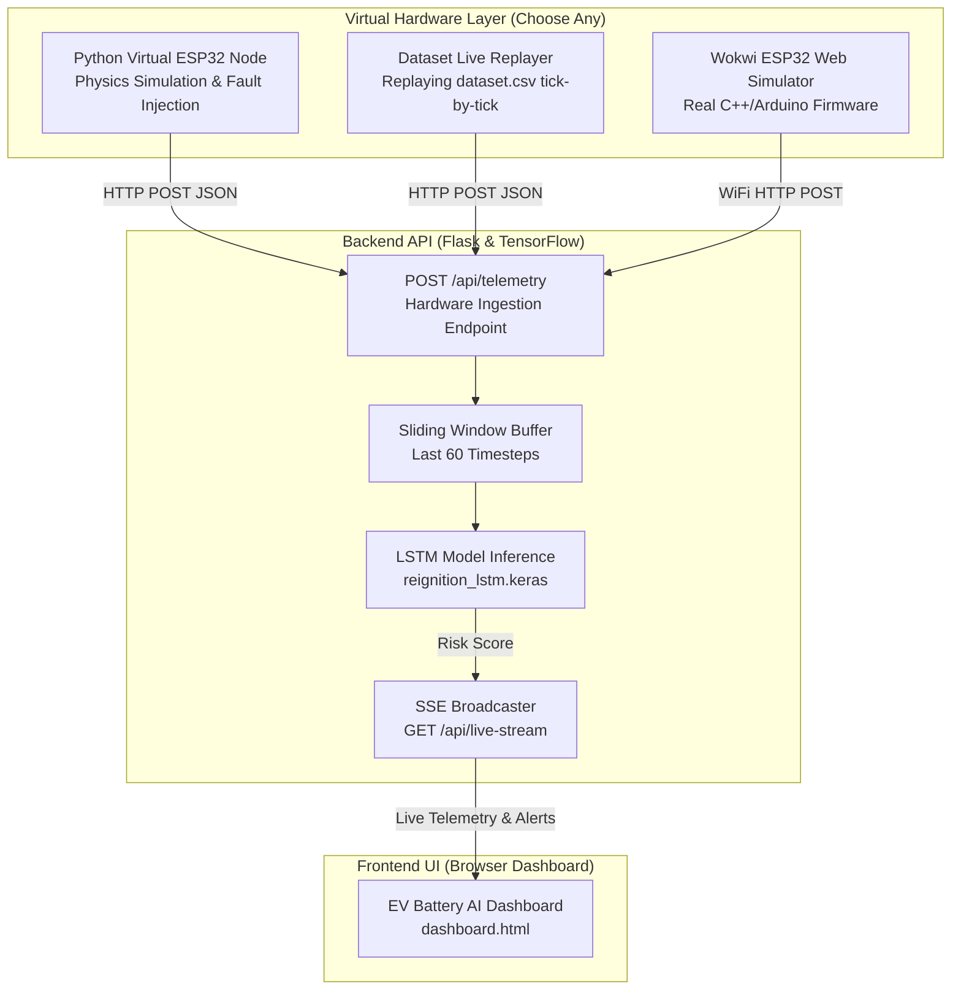

# Implementation Plan: Virtual Hardware & Live Dataset Ingestion for EV Battery AI Monitor

## Goal Description
Enable the EV Battery AI Monitor system to run with **virtual hardware** (simulated ESP32 microcontroller and physical sensors) and stream **live datasets** in real time. This allows end-to-end hardware-in-the-loop (HIL) testing without needing physical battery cells, flammable gases, or physical microcontrollers.

---

## User Review Required

> [!IMPORTANT]
> **Architecture Decision: How would you prefer the Virtual Hardware to run?**
> We recommend a hybrid approach with two flexible options:
> 1. **Option A (Python Virtual Hardware & Live Dataset Daemon - Recommended for instant setup)**: A standalone Python script (`virtual_hardware.py`) that acts as an ESP32 node. It can run in physics-simulation mode (with fault injection) or replay sequences from `dataset.csv` tick-by-tick, pushing real HTTP/JSON packets to the backend.
> 2. **Option B (Wokwi Online ESP32 Simulator)**: An actual ESP32 C++ Arduino sketch running in the free Wokwi simulator (with virtual DHT22/thermistor sensors, potentiometers for voltage/gas, and WiFi stack) transmitting live telemetry via HTTP POST to your local backend.

> [!NOTE]
> Currently, `backend/server.py` creates data internally inside the `GET /api/stream` endpoint. To support virtual or real hardware, we will add an ingestion endpoint (`POST /api/telemetry`) and a real-time event broadcaster so external hardware can feed the dashboard.

---

## System Architecture



---

## Proposed Changes

### Component 1: Backend Ingestion & Telemetry Pipeline (`backend/server.py`)

#### [MODIFY] [backend/server.py](file:///d:/MAIN%20PROJECT/backend/server.py)
- Add thread-safe in-memory sliding buffer (`collections.deque(maxlen=60)`) to store live incoming readings.
- Add `POST /api/telemetry` endpoint:
  - Accepts: `{"temp1": float, "temp2": float, "voltage": float, "gas": float, "device_id": str, "timestamp": str}`
  - Normalizes data with `norm_mean.npy` and `norm_std.npy`.
  - Runs LSTM inference dynamically whenever new sensor readings arrive.
  - Broadcasts `{reading, risk, t, source: "hardware"}` to all connected SSE clients.
- Add `GET /api/live-stream` endpoint for continuous real-time broadcast from the hardware buffer.
- Preserve backward compatibility for existing simulated scenarios (`?scenario=safe|risk`).

```python
# Conceptual Snippet for backend/server.py
telemetry_buffer = deque(maxlen=WINDOW_SIZE)
subscribers = []

@app.route("/api/telemetry", methods=["POST"])
def ingest_telemetry():
    data = request.get_json()
    temp1 = float(data.get("temp1", 25.0))
    temp2 = float(data.get("temp2", 25.0))
    voltage = float(data.get("voltage", 3.0))
    gas = float(data.get("gas", 0.0))
    
    reading = [temp1, temp2, voltage, gas]
    telemetry_buffer.append(reading)
    risk = predict_risk(list(telemetry_buffer)) if len(telemetry_buffer) >= 5 else 0.0
    
    broadcast_to_clients({"t": time.time(), "reading": data, "risk": risk, "source": "hardware"})
    return jsonify({"status": "received", "risk": risk}), 200
```

---

### Component 2: Virtual Hardware Simulator (`virtual_hardware.py`)

#### [NEW] [virtual_hardware.py](file:///d:/MAIN%20PROJECT/virtual_hardware.py)
A full-featured virtual hardware node that behaves like physical IoT hardware.
Features:
- **Modes**:
  1. **Live Physics Mode**: Generates realistic physics cooldown with thermal runaway / stranded energy spikes.
  2. **Dataset Replay Mode**: Reads sequence samples from `dataset.csv` line-by-line at configurable intervals (e.g. 500ms or 1s per tick) to simulate live sensor feeds from real/synthetic battery records.
  3. **Interactive Fault Injection**: Allows pressing keys in terminal (e.g. `[s]` = Normal Cooldown, `[r]` = Trigger Reignition / Gas Spike, `[v]` = Voltage Collapse).
- Outputs ANSI formatted logs showing packets transmitted, response codes, and risk predictions.

---

### Component 3: Wokwi ESP32 Virtual Hardware Firmware (`firmware/esp32_wokwi/`)

#### [NEW] [firmware/wokwi_diagram.json](file:///d:/MAIN%20PROJECT/firmware/wokwi_diagram.json) & [firmware/esp32_sensor_node.ino](file:///d:/MAIN%20PROJECT/firmware/esp32_sensor_node.ino)
- Complete Arduino C++ sketch and Wokwi circuit diagram.
- Simulates:
  - ESP32 Microcontroller
  - 2x NTC Thermistors or DS18B20 (Temperature probes)
  - Potentiometer 1 (Pack voltage divider simulation)
  - Potentiometer 2 / MQ-2 Gas sensor (Gas/VOC ppm simulation)
  - OLED Display (shows local risk score and pack stats)
  - WiFi client sending HTTP POST packets to backend `/api/telemetry`

---

### Component 4: Dashboard Hardware Status UI (`dashboard.html`)

#### [MODIFY] [dashboard.html](file:///d:/MAIN%20PROJECT/dashboard.html)
- Add "Hardware Source" toggle:
  - **Virtual Hardware / Live IoT** (listens to live `/api/live-stream`)
  - **Dataset Replay** (stream stored sequences from CSV)
  - **Synthetic Demo** (current test scenarios)
- Add a "Hardware Connection Indicator" (showing ping latency, device ID, packet counter).

---

## Verification Plan

### Automated Tests
1. **API Telemetry Ingestion Test**:
   - Send mock sensor packets via `curl` / `requests` to `POST /api/telemetry`.
   - Verify 200 OK response and valid risk prediction (`0.0 <= risk <= 1.0`).
2. **Buffer Sliding Test**:
   - Stream 70 packets in succession; ensure buffer caps at 60 timesteps and inference remains stable without memory leak.

### Manual Verification
1. Start `backend/server.py`.
2. Start `virtual_hardware.py --mode dataset --interval 0.5`.
3. Open `dashboard.html` in browser.
4. Verify that live sensor cards (Temp 1, Temp 2, Voltage, Gas) and Chart.js graphs update tick-by-tick from the virtual hardware feed.
5. Trigger a reignition risk scenario and verify the emergency overlay, siren audio, and browser push alert trigger smoothly.
